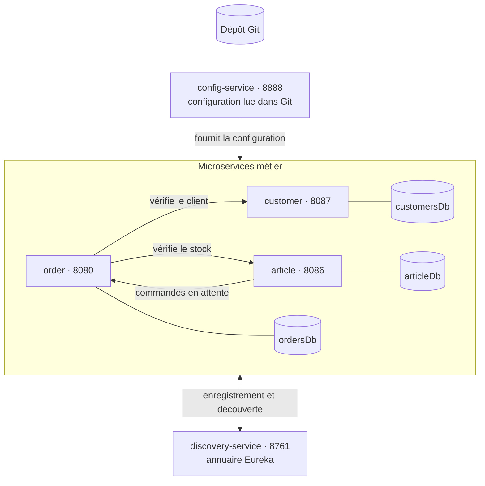

# archi_code
If you want to take a look at config, go to my other repositery, architecture_service.

## Microservices

article 8086 Gestion du stock (ajout d'articles, suppressions, mise à jour) - vérification du stock pour un article donné - liste des commandes en attente d'approvisionnement 
customer 8087 Gérer les clients (enregistrement, suppression, mise à jour) 
order 8080 Gérer les commandes (création, suppression, mise à jour) -  à la création, vérifie le client et le stock puis fixe le statut validee, en_cours ou rejetee - liste des commandes par statut (GET /orders/status/{status}) 

msdiscovery 8761 - service discovery eureka 
config 8888 service de configuration - hébergé sur git 

## Explication du nombre de microservices

Pourquoi cette division ? La vérification du stock était commun à OrderService / InventoryService donc j'ai fait un 3e service dédié uniquement au stock (Article). Ensuite Order et Inventory Service avaient déjà un périmètre bien défini donc j'ai gardé. 

## Choix de la db décentralisée

Choix de db décentralisés : Les db décentralisés demandent des appels réseau (order-service interroge customer-service et inventory-service), et la cohérence n'est plus garantie par une transaction unique : si le stock change entre la vérification et la création d'une commande, il y a un problème. Mais elles sont plus simple à comprendre, à maintenir et un peu plus résiliente. Donc j'ai considéré que pour un exercice comme celui-ci, avoir 3 db différentes était acceptable. 

## Architecture 

