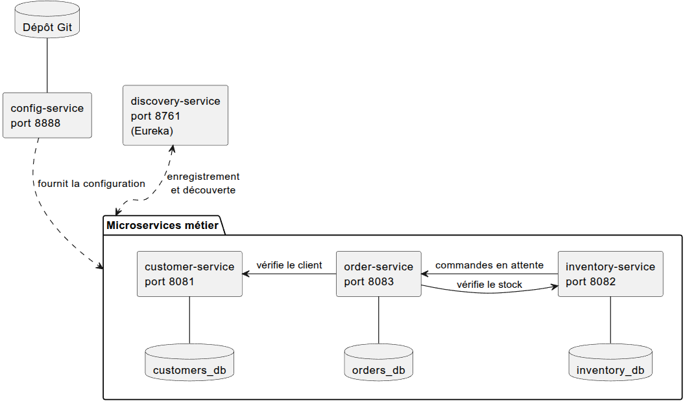

# TD 6 - de services à microservices

Matteo

## Microservices

Chaque microservice métier a les fonctions de base inclues : GET, POST, PUT, DELETE. Certains microservices ont des fonctionnalités supplémentaires, comme **order** qui, quand on créer une commande vérifie que le client existe en demander au microservice **customer** qui regarde sa db, et vérifie que le stock est suffisant en demandant au microservice **article** qui regarde sa db. 

- **article** 8086 Gestion du stock (ajout d'articles, suppressions, mise à jour) - vérification du stock pour un article donné - liste des commandes en attente d'approvisionnement   
- **customer** 8087 Gérer les clients (enregistrement, suppression, mise à jour) 
- **order** 8080 Gérer les commandes (création, suppression, mise à jour) -  à la création, vérifie le client et le stock puis fixe le statut validee, en_cours ou rejetee - liste des commandes par statut (GET /orders/status/{status})  

- **msdiscovery** 8761 - service discovery eureka  
- **config** 8888 service de configuration - hébergé sur git 

## Organisation des fichiers

Pour les 5 microservices, il y a un projet différent. ArticleManagement est le projet pour le microservice **article**, ConfigServer pour le microservice **config**... Et config est le dossier où il y a  les .properties de chaque microservice métier. Ce dossier config est accesible ici :  https://github.com/ElFamosoBob/architecture_service

## Explication du nombre de microservices

Pourquoi cette division ? La vérification du stock était commun à OrderService / InventoryService donc j'ai fait un 3e service dédié uniquement au stock (Article). Ensuite Order et Inventory Service avaient déjà un périmètre bien défini donc je les ai gardé tel quel.

## Choix des db décentralisées

Choix de db décentralisées : Les db décentralisés demandent des appels réseau (order-service interroge customer-service et inventory-service), et la cohérence n'est plus garantie par une transaction unique : si le stock change entre la vérification et la création d'une commande, il y a un problème. C'est donc plus complexe à gérer qu'une db centralisée. Mais elles séparent mieux les microservices, permettant par exemple de travailler sur une db en bloquant seulement un microservices et pas tous.  On a aussi plus de résilience, si une db est down, seulement un microservice est affecté. 

## Architecture 

